<!-- HEADER -->
<p align="center">
  
</p>

<!-- TYPING ANIMATION -->
<p align="center">
  
</p>

<p align="center">
  
</p>

---

### `> cat about.txt`

```bash
saksham@github:~$ whoami
saksham hada

saksham@github:~$ cat status.txt
role      : first-semester BTech CSE (AI & ML) student
school    : Bosscoder School of Technology
interests : everything in CS, hardware and software
currently : HTML/CSS foundations, Linux, bash scripting
goal      : touch every corner of CS

saksham@github:~$ echo $MOTTO
break things, fix things, learn things
```

---

### `> ls ~/skills`

<p align="center">
  
</p>

---

### `> ./stats.sh`

<p align="center">
  
  
</p>

<p align="center">
  
</p>

---

### `> tail -f contributions.log`

<p align="center">
  
</p>

---

### `> ls ~/projects`

- `html-css-projects` : 13 small HTML/CSS practice projects ([repo](https://github.com/sakshamhada-tech/YOUR-REPO-NAME))
- more loading...

---

### `> ping saksham`

<p align="center">
  <a href="https://github.com/sakshamhada-tech"></a>
  <!-- add LinkedIn / email badges here if you want -->
</p>

<p align="center">
  
</p>
